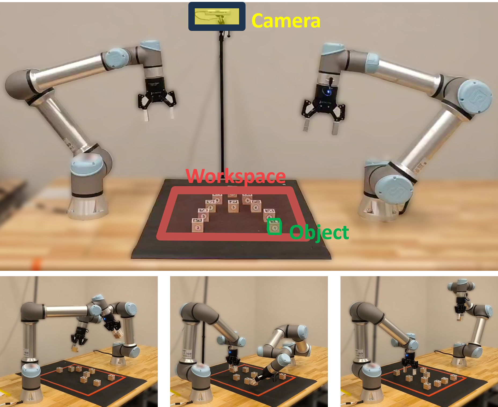

# High-Performance Dual-Arm Task and Motion Planning for Tabletop Rearrangement [](https://arxiv.org/pdf/2512.08206) [](#citation)

<a href="https://duozhangrobotics.github.io/" target="_blank"><nobr>Duo Zhang</nobr></a> &emsp;
<a href="https://duozhangrobotics.github.io/" target="_blank"><nobr>Junshan Huang</nobr></a> &emsp;
<a href="https://arc-l.github.io/group.html" target="_blank"><nobr>Jingjin Yu</nobr></a> &emsp; (Accepted to [ICRA 2026](https://2026.ieee-icra.org/))



## Table of Contents
- [Introduction](#intro)
  - [What This Repository Does](#what)
  - [Methods and Variants](#methods)
- [Installation](#install)
- [Usage](#usage)
  - [Run a Single Case](#single-case)
- [Task JSON Format](#json-format)
- [Citation](#citation)

## <a name="intro"></a>Introduction
### <a name="what"></a>What this repository does
This repository implements the **Synchronous Dual-Arm Rearrangement Planner (SDAR)** from the paper, a dual-arm task-and-motion-planning (TAMP) framework for dense tabletop object rearrangement with two robot arms and 2-finger grippers. SDAR tightly couples:

- **SDAR-T**: a dependency-driven dual-arm task planner that decomposes rearrangement problems using a dependency graph (independent objects, chains, and cycles) and produces high-quality next-step sub-task candidates.
- **SDAR-M**: a synchronous dual-arm motion planner that samples grasp poses / sub-task instantiations, uses GPU-accelerated CuRobo IK + motion generation, and applies layered fallback recovery when optimized synchronous motion is not available.

This codebase includes:

- A dual-arm planner (`dual_arms.py`) using CuRobo-based motion planning.
- Benchmark scripts for evaluating multiple planner combinations on generated task instances.
- Utilities for generating task instances and visualizing results.

The evaluation setup covers synthetic tabletop rearrangement instances with strongly entangled start/goal configurations, including categories such as `random`, `cycled`, `double_cycled`, and `mixed` (corresponding to dependency-graph structures discussed in the paper).

### <a name="methods"></a>Methods and variants
`evaluation.py` currently supports the following methods:

- `ours` (full **SDAR**: dependency-driven dual-arm task planning + synchronous dual-arm motion planning with fallback recovery)
- `our_tp_with_curobo` (uses **SDAR-T** task planning with a CuRobo-based motion-planning pipeline)

## <a name="install"></a>Installation

### 1. Create the conda environment
```bash
conda env create -f environment.yml
conda activate dual_arm_tamp
```

### 2. Install CuRobo from the following repo 

Please use the CuRobo repo provided by the author for this project:

https://github.com/DuoZhangRobotics/curobo_dual_ur5e

Reason: the official CuRobo repo had bugs when attaching objects in a multi-arm system.  
Reference issue: https://github.com/NVlabs/curobo/issues/553

## <a name="usage"></a>Usage

### <a name="single-case"></a>Run a single case
Run one method on one tabletop rearrangement task JSON file:
```bash
python evaluation.py --input data/cycled_objects_4.json --method ours
```

Example (`our_tp_with_curobo` ablation-style variant):

```bash
python evaluation.py --input data/cycled_objects_4.json --method our_tp_with_curobo
```

## <a name="json-format"></a>Task JSON Format
Tasks are loaded using `Task.read_from_json(...)` in `task.py`.

Required fields:
- `starts`: list of object poses `[x, y, z]`
- `goals`: list of object poses `[x, y, z]`
- `object_size`: cube side length (meters)
- `map_width`: workspace width (meters)
- `map_length`: workspace length (meters)

Example:

```json
{
  "starts": [
    [-0.11826439433444093, -0.11124986556905428, 0.0225],
    [0.13192161251950177, 0.157525877115014, 0.0225]
  ],
  "goals": [
    [0.13192161251950177, 0.157525877115014, 0.0225],
    [-0.11826439433444093, -0.11124986556905428, 0.0225]
  ],
  "object_size": 0.045,
  "map_width": 0.6,
  "map_length": 0.6
}
```

## <a name="citation"></a>Citation

If you use this codebase, please cite:
```bibtex
@inproceedings{ZhaHuaYu26ICRA,
author = {Duo Zhang and Junshan Huang and Jingjin Yu},
title = {High-Performance Dual-Arm Task and Motion Planning for Tabletop Rearrangement},
booktitle={IEEE International Conference on Robotics and Automation},
year={2026} }
```
