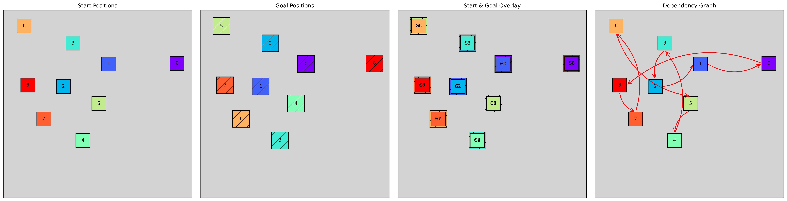
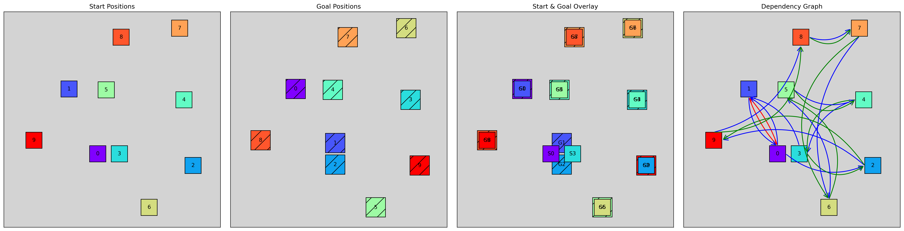
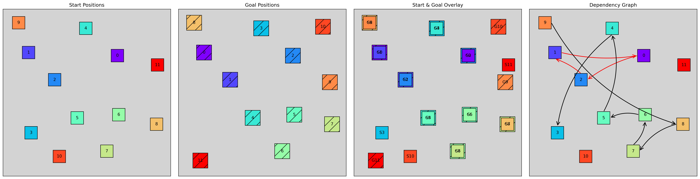
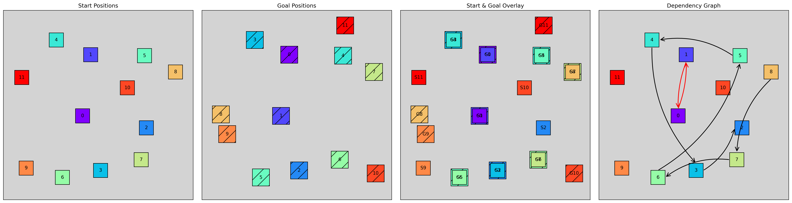

# High-Performance Dual-Arm Task and Motion Planning for Tabletop Rearrangement [](https://arxiv.org/pdf/2512.08206) [](#citation)

<a href="https://duozhangrobotics.github.io/" target="_blank"><nobr>Duo Zhang</nobr></a> &emsp;
<a href="https://duozhangrobotics.github.io/" target="_blank"><nobr>Junshan Huang</nobr></a> &emsp;
<a href="https://arc-l.github.io/group.html" target="_blank"><nobr>Jingjin Yu</nobr></a> &emsp; (Accepted to [ICRA 2026](https://2026.ieee-icra.org/))


<div align="center">
<p float="left">
  
  
  
</p>
</div>

## Table of Contents
- [Introduction](#intro)
  - [What This Repository Does](#what)
  - [Methods and Variants](#methods)
  - [Dataset / Task Examples](#examples)
- [Installation](#install)
- [Usage](#usage)
  - [Run a Single Case](#single-case)
  - [Run All Cases](#all-cases)
  - [Evaluate Task Planner Only](#task-planner-only)
  - [Visualize Aggregate Results](#visualize)
- [Task JSON Format](#json-format)
- [Repository Structure](#repo-structure)
- [Citation](#citation)

## <a name="intro"></a>Introduction
### <a name="what"></a>What this repository does
This repository implements a dual-arm task and motion planning (TAMP) pipeline for object rearrangement on a tabletop. It includes:

- A dual-arm planner (`dual_arms.py`) using CuRobo-based motion planning.
- A baseline rearrangement pipeline (`baseline_dual_arm.py` + `baseline/`).
- Benchmark scripts for evaluating multiple planner combinations on generated task instances.
- Utilities for generating task instances and visualizing results.

The codebase appears to compare task-planning and motion-planning combinations (e.g., "ours", baseline, and hybrid variants) across synthetic rearrangement datasets such as `random`, `cycled`, `double_cycled`, and `mixed`.

### <a name="methods"></a>Methods and variants
`evaluation.py` currently supports the following methods:

- `ours`
- `baseline`
- `baseline_with_our_tp`
- `ours_with_baseline_tp`
- `our_tp_with_curobo`
- `baseline_tp_with_curobo`

These names correspond to different combinations of task planning (TP) and motion planning (MP) components. If you are preparing a paper release, this is a good place to add a short mapping from method names to algorithm descriptions.

### <a name="examples"></a>Dataset / Task Examples
The repository includes pre-generated task JSON files in `data/` and visualization images in `data_vis/`.

<div align="center">
<p float="left">
  
  
  
  
</p>
</div>

## <a name="install"></a>Installation

### 1. Create the conda environment
```bash
conda env create -f environment.yml
conda activate dual_arm_tamp
```

### 2. Install external dependencies not captured in `environment.yml`
This repository imports packages that are not installed by `environment.yml`, most notably:

- `curobo`
- `torch` (CUDA-enabled build recommended / likely required)

It also relies on GPU acceleration and CuRobo robot/world configs (via `curobo.util_file.get_robot_configs_path()`).

Placeholders to fill:
- [ ] Exact PyTorch version
- [ ] Exact CUDA version (the code checks for CUDA `>= 12.0` in `dual_arms.py`)
- [ ] CuRobo installation instructions (pip / source / Isaac Sim compatible version)
- [ ] Any system packages required for `pybullet` / `toppra`

### 3. (Optional) Baseline simulation environment
There is an additional environment file at `baseline/simulation/requirements.yml` for parts of the baseline stack. If your baseline path requires extra packages, document the exact setup here.

## <a name="usage"></a>Usage

### <a name="single-case"></a>Run a single case
Run one method on one task JSON file:

```bash
python evaluation.py --input data/cycled_objects_4.json --method ours
```

Example methods:

```bash
python evaluation.py --input data/cycled_objects_4.json --method baseline
python evaluation.py --input data/cycled_objects_4.json --method baseline_with_our_tp
python evaluation.py --input data/cycled_objects_4.json --method ours_with_baseline_tp
python evaluation.py --input data/cycled_objects_4.json --method our_tp_with_curobo
python evaluation.py --input data/cycled_objects_4.json --method baseline_tp_with_curobo
```

Notes:
- `evaluation.py` creates `results/` outputs (e.g., timing stats for some methods).
- GUI / headless behavior is configured inside `evaluation.py` and planner constructors.

### <a name="all-cases"></a>Run all cases
Run all JSON files in `data/` for a single method:

```bash
bash run.sh ours
```

Run the bundled two-pass script (`ours` then `baseline`):

```bash
bash run_all.sh
```

### <a name="task-planner-only"></a>Evaluate task planner only (action count)
To compare only task-planner outputs (number of actions / action lists), use:

```bash
python evaluate_task_planner.py --input data/cycled_objects_4.json --method ours
python evaluate_task_planner.py --input data/cycled_objects_4.json --method baseline
```

Batch script:

```bash
bash run_all_task_plan.sh
```

### <a name="visualize"></a>Visualize aggregate results
After populating `results/` (e.g., duration files), generate comparison plots:

```bash
python visualize_execution_time.py
```

This script saves plots such as:
- `results/execution_time_comparison.png`
- `results/success_rate_comparison.png`
- `results/execution_time_ratios_boxplot.png`

## <a name="json-format"></a>Task JSON Format
Tasks are loaded using `Task.read_from_json(...)` in `task.py`.

Required fields:
- `starts`: list of object poses `[x, y, z]`
- `goals`: list of object poses `[x, y, z]`
- `object_size`: cube side length (meters)
- `map_width`: workspace width (meters)
- `map_length`: workspace length (meters)

Example:

```json
{
  "starts": [
    [-0.11826439433444093, -0.11124986556905428, 0.0225],
    [0.13192161251950177, 0.157525877115014, 0.0225]
  ],
  "goals": [
    [0.13192161251950177, 0.157525877115014, 0.0225],
    [-0.11826439433444093, -0.11124986556905428, 0.0225]
  ],
  "object_size": 0.045,
  "map_width": 0.6,
  "map_length": 0.6
}
```

## <a name="repo-structure"></a>Repository Structure

- `dual_arms.py`: Main dual-arm environment and planning pipeline (CuRobo + PyBullet/TOPPRA integration).
- `baseline_dual_arm.py`: Baseline wrapper and hybrid evaluation modes.
- `evaluation.py`: Main experiment entry point for planner/method comparisons.
- `evaluate_task_planner.py`: Task-planning-only comparison script.
- `task.py`: Task representation, task generation, JSON IO, dependency graph logic.
- `helper.py`: Plan serialization helpers and utility functions.
- `run.sh`, `run_all.sh`, `run_all_task_plan.sh`: Batch evaluation scripts.
- `visualize_execution_time.py`: Plotting utility for benchmark summaries.
- `data/`: Task JSON files.
- `data_vis/`: Dataset visualization images.
- `baseline/`: Baseline task/motion planning implementations and benchmark data.
- `assets/`: Robot assets (e.g., URDFs).

## <a name="citation"></a>Citation

If you use this codebase, please cite:
```bibtex
@inproceedings{ZhaHuaYu26ICRA,
author = {Duo Zhang and Junshan Huang and Jingjin Yu},
title = {High-Performance Dual-Arm Task and Motion Planning for Tabletop Rearrangement},
booktitle={IEEE International Conference on Robotics and Automation},
year={2026} }
```