## Usage:
1. Setup the conda environment and activate it:
```bash=
conda env create -f environment.yml
conda activate dual_arm_tamp
```

2. To run the code, please run
```bash=
python experiments.py --gui
```


<!-- Start -->
## Random Objects
### 4 objects
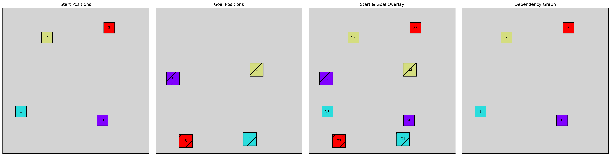
### 5 objects
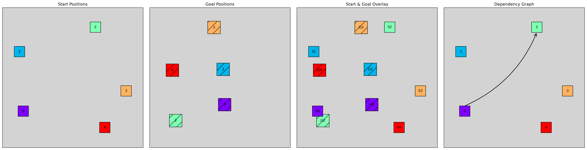
### 6 objects
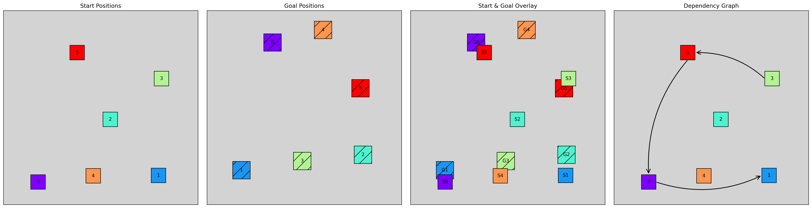
### 7 objects
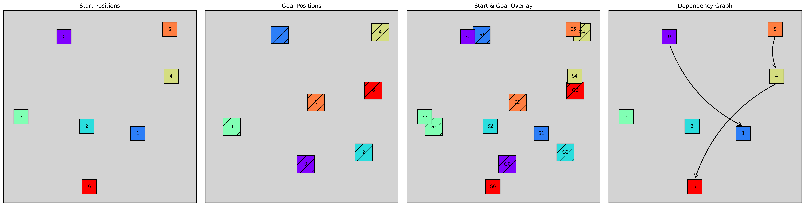
### 8 objects
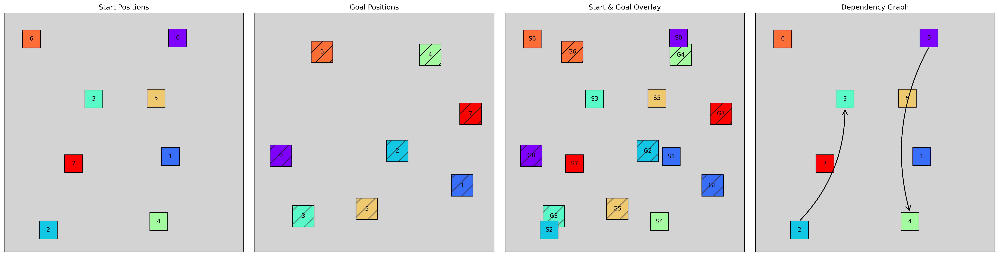
### 9 objects
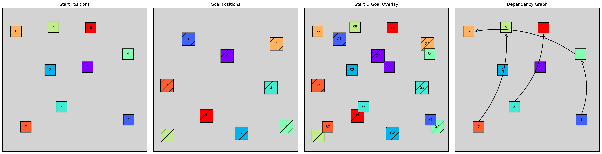
### 10 objects
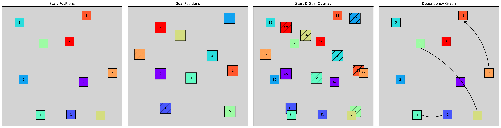
### 11 objects
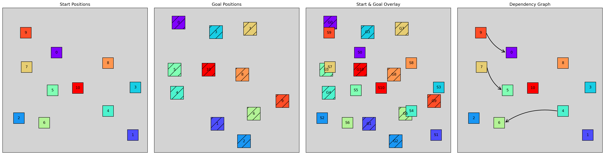
### 12 objects
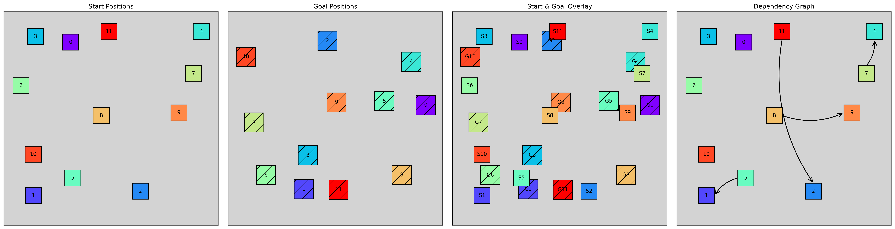
### 13 objects
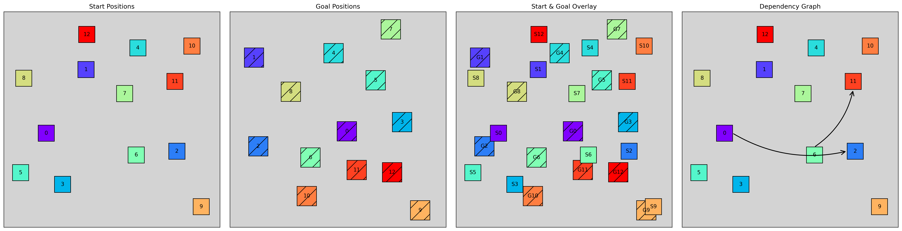
### 14 objects
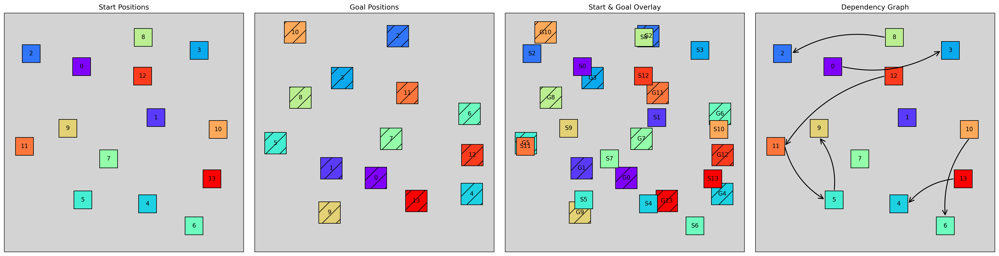
### 15 objects
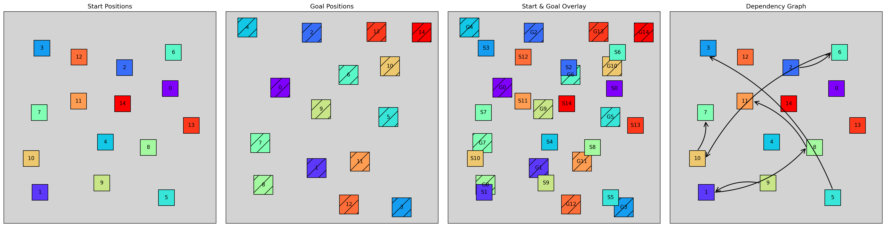
### 16 objects
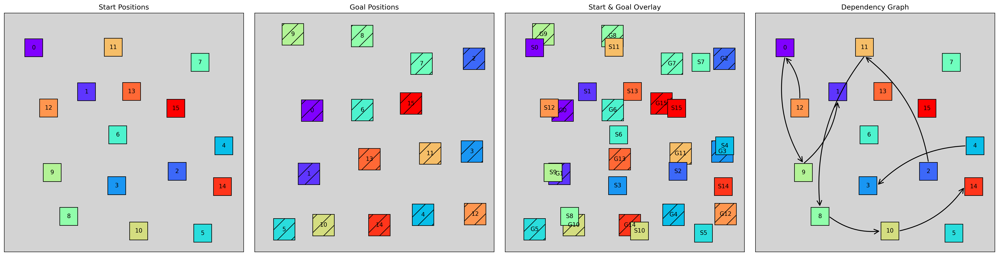
### 17 objects
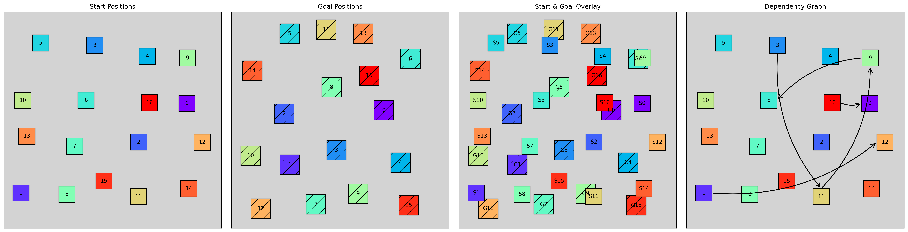
### 18 objects
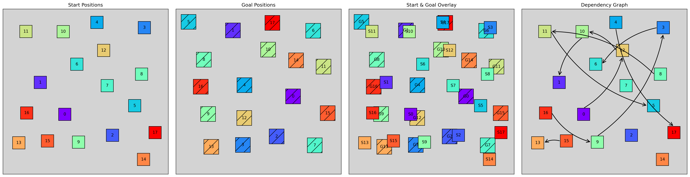
## Cycled Objects
### 4 objects
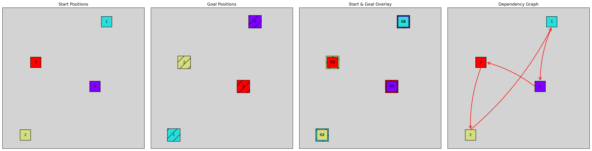
### 5 objects
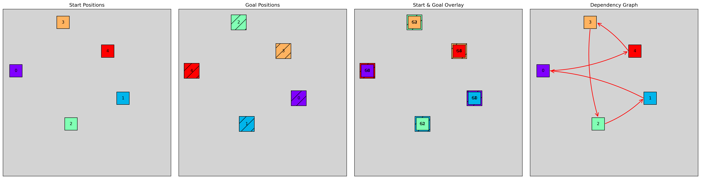
### 6 objects
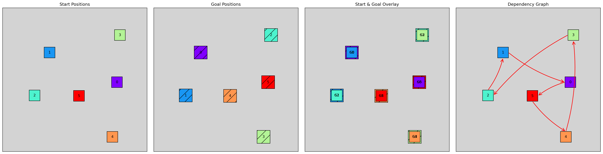
### 7 objects
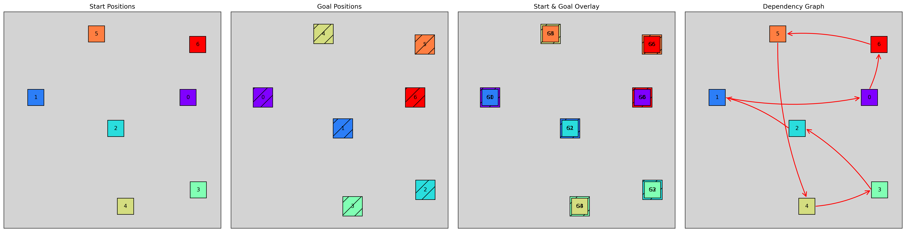
### 8 objects
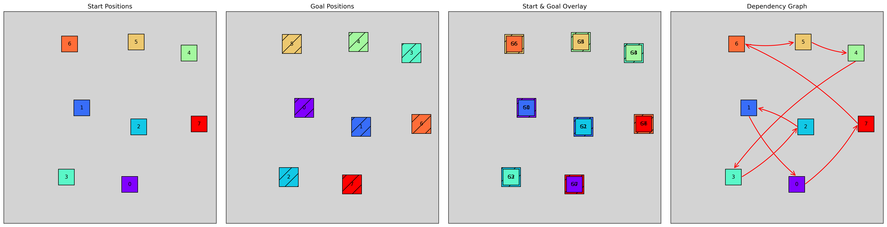
### 9 objects

### 10 objects
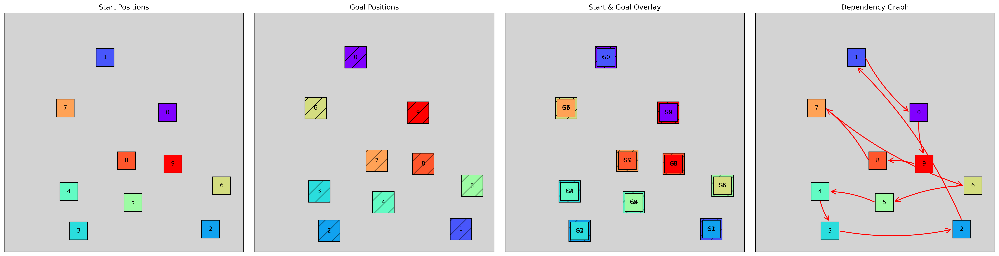
### 11 objects
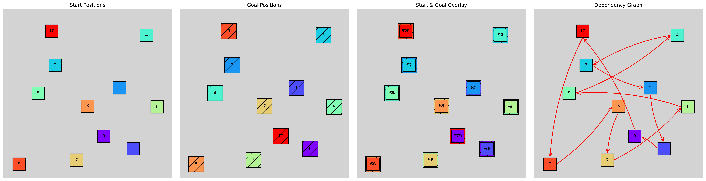
### 12 objects
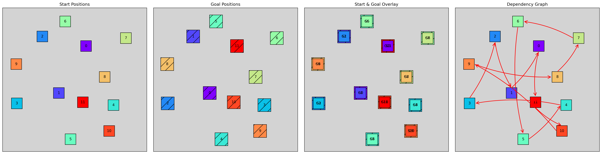
## Double Cycled Objects
### 6 objects
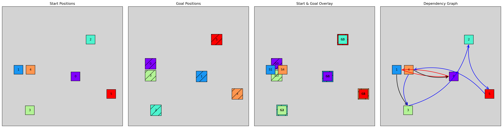
### 7 objects
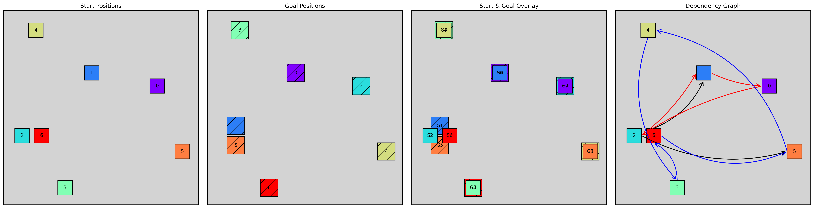
### 8 objects
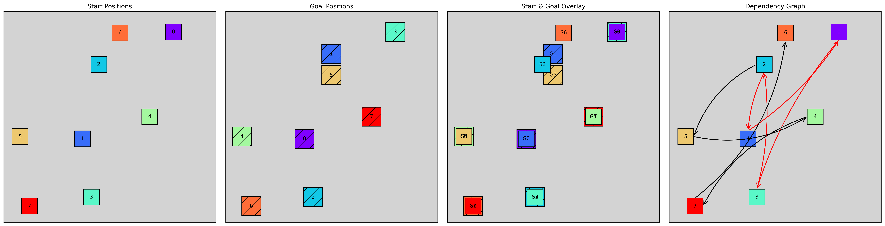
### 9 objects
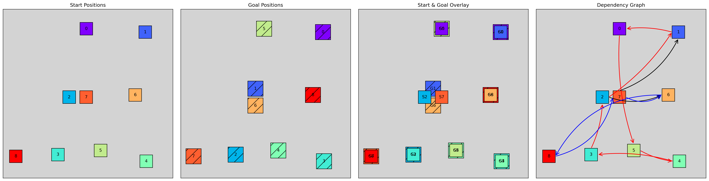
### 10 objects

### 11 objects
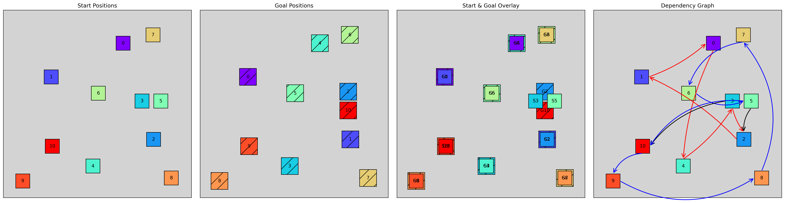
### 12 objects
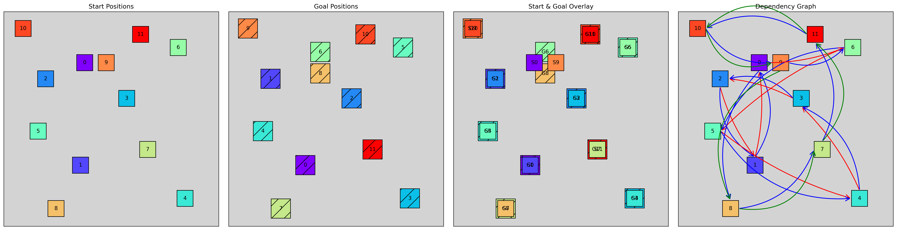
